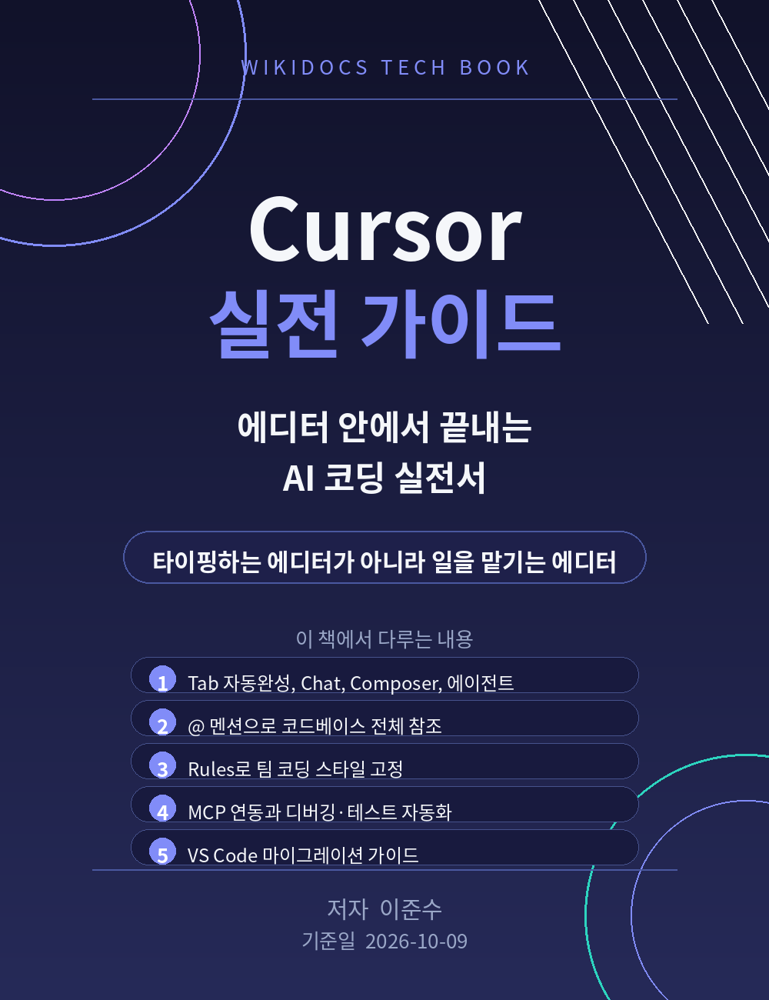

# Cursor 실전 가이드

AI와 나란히 코드를 짜는 가장 빠른 방법. 이 책은 Cursor 에디터를 처음 설치하는 순간부터 에이전트 모드로 기능을 통째로 만드는 단계까지, 하루치 연습으로 실제 업무에 써먹을 수 있게 구성했습니다.

저자: 이준수 / 기준일: 2026-10-09

이 책은 무료로 공개됩니다. 누구나 읽고, 공유하고, 업무에 바로 써도 됩니다.

문의: 이메일 1130dlwltn2@gmail.com / 인공지능 정보공유 단톡방 https://open.kakao.com/o/s4OEqBai
