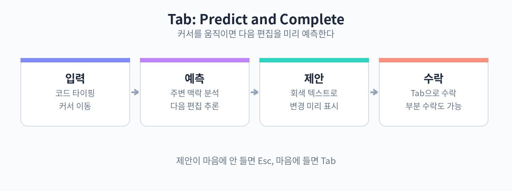

# Part 2. Tab 자동완성

## 20. Tab으로 완성하기

Tab 자동완성은 Cursor에서 가장 자주 마주치는 기능이다. 코드를 타이핑하다 보면 다음에 올 내용이 회색 텍스트로 미리 나타난다. 마음에 들면 Tab을 눌러 확정하고, 아니면 Esc를 눌러 무시한다. 단순해 보이지만, 익숙해지면 타이핑량이 눈에 띄게 줄어든다.

동작 방식은 이렇다. Cursor가 현재 파일의 내용, 커서 위치, 주변 코드의 패턴을 보고 다음 편집을 예측한다. 단순한 단어 완성이 아니라 여러 줄에 걸친 코드 블록을 통째로 제안하기도 한다. 예를 들어 함수 시그니처를 쓰고 본문을 시작하면, 함수 전체의 뼈대를 회색으로 보여 주는 식이다.



실제로 써보자. 새 파일에 아래 코드를 타이핑해 본다. 천천히, 한 줄씩 입력하면서 회색 제안을 관찰하자.

```python
def calculate_total(items):
    total = 0
```

`total = 0`까지 입력하고 엔터를 치면, Cursor가 for 루프를 회색으로 제안할 가능성이 높다. Tab을 눌러 수락하면 이렇게 완성된다.

```python
def calculate_total(items):
    total = 0
    for item in items:
        total += item["price"] * item["quantity"]
    return total
```

제안이 길어서 일부만 쓰고 싶을 때는 부분 수락을 쓴다. 단축키는 설정에서 확인할 수 있으며, 보통 단어를 하나씩 받아들이는 방식으로 동작한다. 제안의 앞부분만 맞고 뒷부분이 틀렸을 때 유용하다.

자동완성은 편집 중에도 계속 따라다닌다. 기존 코드를 수정할 때, 예를 들어 변수명을 바꾸면 그 변수를 쓰는 다른 줄에도 회색으로 변경 제안이 뜬다. 커서를 옮겨 다니며 Tab을 누르는 것만으로 여러 줄을 일관되게 고칠 수 있다.

주의할 점이 있다. 자동완성은 문맥을 보고 예측할 뿐, 의도를 아는 것이 아니다. 비슷한 패턴의 코드가 근처에 있으면 그 패턴을 따라가는데, 그 패턴 자체가 버그를 포함하고 있을 수도 있다. 특히 처음 보는 라이브러리를 쓸 때는 제안된 함수명이나 인자 순서가 틀린 경우가 있다. 회색 텍스트는 항상 한 번 읽고 수락하는 습관을 들이자. 빠르게 Tab을 연타하다 보면 잘못된 코드가 슬그머니 들어간다.

또 하나, 자동완성이 뜨지 않는다고 고장 난 것은 아니다. 예측 확신이 낮으면 제안을 띄우지 않는다. 애매한 상황에서는 그냥 직접 타이핑하면 된다. AI에게 전적으로 맡기는 것이 아니라, AI가 잘하는 구간에서만 도움을 받는다는 감각이 중요하다.

핵심 정리
- 타이핑 중 회색 텍스트로 다음 편집을 예측하고, Tab으로 수락·Esc로 취소한다.
- 부분 수락으로 제안의 일부만 받아들일 수 있다.
- 제안은 항상 한 번 읽고 수락한다. 예측이 틀릴 수 있다는 점을 잊지 않는다.
