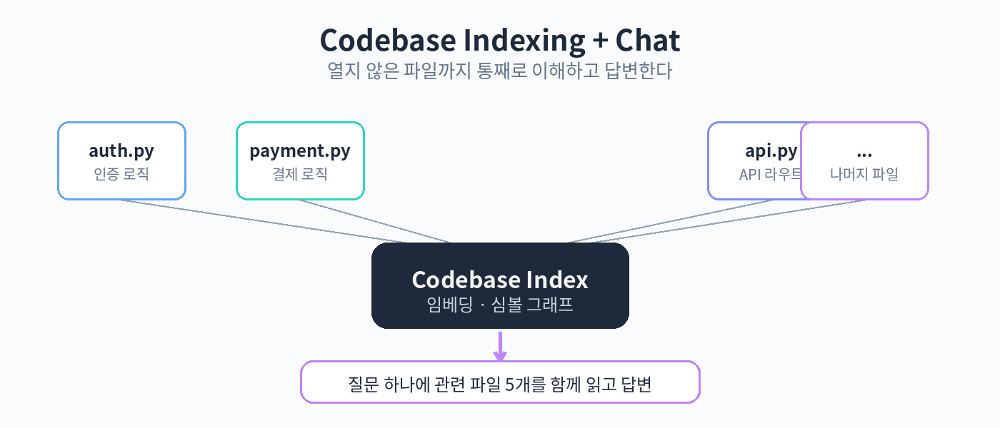

# Part 3. Chat과 코드베이스 이해

## 30. Chat 패널

Chat은 Cursor의 사이드 패널에서 AI와 대화하는 기능이다. 코드를 붙여넣지 않아도 된다. Cursor가 코드베이스 전체를 미리 인덱싱해 두었기 때문에, 열지 않은 파일까지 참조해서 답할 수 있다.

인덱싱은 이렇게 동작한다. 프로젝트를 처음 열면 Cursor가 파일들을 스캔해서 임베딩과 심볼 분석을 수행한다. 어떤 파일에 어떤 함수와 클래스가 있는지, 서로 어떻게 참조하는지를 파악해 두는 것이다. 이 인덱스가 있어야 "로그인 흐름이 어떻게 돼?" 같은 질문에 프로젝트 전체를 뒤져서 답할 수 있다.



실제로 써보자. 프로젝트 폴더를 열고 Chat 패널을 연다. 단축키는 설정에서 확인할 수 있다. 그리고 이렇게 물어본다.

```
이 프로젝트의 진입점이 되는 파일은 뭐야?
```

Cursor가 인덱싱한 정보를 바탕으로 답할 것이다. 인덱싱이 끝나지 않은 상태라면 부정확한 답이 나올 수 있으니, 인덱싱 상태를 먼저 확인하자.

다음 질문으로 깊이를 더해 보자.

```
사용자 인증 흐름을 파일 단위로 설명해 줘
```

Chat은 관련 파일들을 찾아서 흐름을 설명해 줄 것이다. 설명을 읽다가 특정 부분이 궁금하면 후속 질문을 이어간다. "그중에서 토큰 갱신은 어디서 처리돼?" 같은 식이다. 대화가 이어질수록 맥락이 쌓이니, 처음 질문을 잘 던지는 것이 중요하다.

Chat의 답을 코드에 반영하는 방법도 있다. Chat이 제안한 코드를 보고 마음에 들면, 해당 파일에 직접 적용할 수 있다. Cursor 3.0부터는 Agents Window가 여러 파일을 넘나드는 편집을 맡으니, 여러 파일에 걸친 변경은 에이전트에게 맡기는 편이 낫다. Chat은 이해와 탐색에, 에이전트는 실행에 쓰는 구분이 실무에서는 편하다.

주의점이 있다. Chat은 인덱싱된 정보를 바탕으로 답하지만, 항상 정확한 것은 아니다. 특히 파일이 최근에 바뀌었는데 인덱스가 갱신되지 않은 상태라면 오래된 정보를 말할 수 있다. 중요한 결정(리팩터링 범위, 삭제 여부 등)을 Chat의 답만으로 내리지 말고, 실제 파일을 열어서 확인하자. Chat은 탐색의 시작점이지 진실의 원천이 아니다.

또 하나, 질문을 너무 크게 던지지 말자. "이 프로젝트 리팩터링해 줘" 같은 질문은 범위가 넓어서 답의 질이 떨어진다. 파일이나 기능 단위로 쪼개서 물어보는 것이 좋다. 작은 질문 여러 개가 큰 질문 하나보다 낫다.

핵심 정리
- Chat은 코드베이스 인덱싱 덕분에 열지 않은 파일까지 참조해서 답한다.
- 질문은 파일이나 기능 단위로 작게 쪼개서 던지는 것이 답의 질을 높인다.
- 중요한 결정은 Chat의 답만 믿지 말고 실제 파일을 열어 확인한다.
