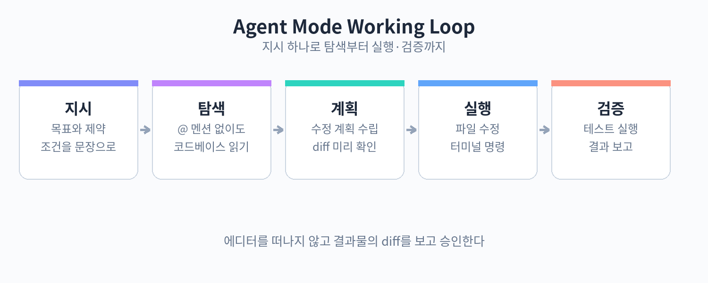

# Part 4. 에이전트 모드로 통째로 만들기

## 40. 에이전트 모드

Chat이 대화로 답을 주고 코드 조각을 제안하는 수준에 머문다면, 에이전트 모드는 한 걸음 더 나아간다. 지시 하나를 주면 코드베이스를 스스로 탐색하고, 계획을 세우고, 여러 파일을 고치고, 터미널에서 명령을 실행하고, 테스트까지 돌려본 뒤 결과를 보고한다. 사용자는 에디터를 떠나지 않고 diff를 확인하며 승인만 하면 된다.

에이전트 모드가 유용한 순간은 작업 범위가 넓을 때다. 예를 들어 "로그인 화면에 다크모드 토글을 추가해줘" 같은 지시는 컴포넌트 수정, 상태 관리, 스타일, 기존 테스트 갱신까지 이어질 수 있다. 이런 작업을 Chat 조각으로 하나씩 붙이다 보면 맥락이 끊기기 쉽다. 에이전트는 같은 세션 안에서 탐색부터 검증까지 연결해서 처리한다.

기본 흐름은 다음과 같다.

1. 단축키(기본값은 설정에서 확인)로 에이전트 입력창을 연다.
2. 원하는 결과를 자연어로 적는다. 가능한 한 구체적으로 적는 것이 좋다.
3. 에이전트가 코드베이스를 탐색하고 계획 초안을 보여준다.
4. 계획을 승인하면 파일 수정과 터미널 명령 실행이 이어진다.
5. 변경된 파일마다 diff가 표시되고, 사용자는 승인하거나 수정 요청을 한다.
6. 에이전트가 테스트나 빌드 결과를 보고하고 작업을 마친다.

에이전트에게 지시를 줄 때는 원하는 최종 상태를 설명하는 방식이 효과적이다. "이 함수 리팩터링해줘"보다는 "이 함수가 40줄이 넘으니 책임별로 세 개로 나누고, 기존 동작이 바뀌지 않게 해줘"처럼 말한다. 맥락이 필요한 파일이 있다면 @ 파일명 형식으로 직접 지정해 주면 탐색 시간을 줄일 수 있다.



위 그림의 순환 구조를 기억하면 좋다. 지시, 탐색, 계획, 실행, 검증은 한 번에 끝나지 않는다. 중간에 계획이 어긋나면 에이전트가 다시 탐색 단계로 돌아가기도 하고, 사용자가 중간에 개입해 방향을 바꿀 수도 있다. 에이전트를 쓰는 일은 전권을 위임하는 것이 아니라, 빠른 피드백으로 방향을 잡아주는 일에 가깝다.

실제 사용 예로, 오래된 유틸 함수에 타입을 붙이는 작업을 맡겨보자. 입력은 이렇게 쓸 수 있다.

```text
src/utils/format.ts의 formatDate 함수를 살펴보고,
날짜 인자에 적절한 타입을 붙여줘.
호출하고 있는 곳도 찾아서 같이 수정해.
수정 후에는 tsc를 실행해서 오류가 없는지 확인해줘.
```

에이전트는 format.ts를 읽고, 코드베이스 전체에서 formatDate를 호출하는 위치를 찾고, 타입을 추가하고, tsc를 돌려 오류가 없음을 확인한 뒤 변경 목록을 보여준다. 사용자는 각 diff를 검토하고 승인하면 된다.

주의할 점도 있다. 첫째, 에이전트는 지시 범위를 스스로 좁히지 않는다. "이거 좀 고쳐줘"처럼 막연한 지시는 엉뚱한 파일을 건드릴 수 있다. 작업 범위를 파일이나 디렉터리 단위로 한정해 주는 습관이 필요하다. 둘째, 실행한 터미널 명령의 결과를 무턱대고 믿지 말고 diff를 눈으로 확인하자. 셋째, 버전이 올라가면 에이전트의 기본 동작(자동 실행 범위, 단축키)이 달라질 수 있으니 공식 문서를 확인하는 습관을 들이자.

핵심 정리
- 에이전트 모드는 탐색, 계획, 다중 파일 수정, 터미널 실행, 테스트 검증을 한 흐름으로 묶어준다.
- 지시는 최종 상태 위주로 구체적으로 쓰고, 범위와 관련 파일은 @ 멘션으로 한정해 주는 것이 효과적이다.
- diff 확인과 계획 검토는 사용자의 몫이며, 모든 과정을 위임하지 않는다.
