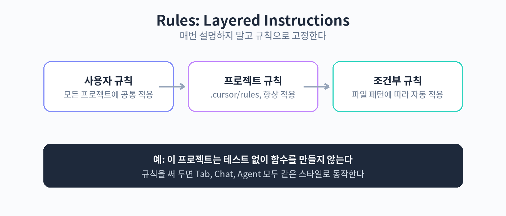

# Part 5. Rules와 팀

## 50. Rules로 팀 코딩 스타일 고정

Cursor를 쓰다 보면 같은 설명을 반복하게 된다. "이 프로젝트는 TypeScript strict 모드야", "함수명은 동사로 시작해", "console.log는 커밋하지 마". 매번 말하지 말고 규칙으로 고정하자. Rules는 에이전트, Chat, Tab 모두에게 적용되는 프로젝트의 행동 지침이다.

Rules는 세 계층으로 구성된다.

첫째, 프로젝트 규칙이다. .cursor/rules 디렉터리 안에 마크다운 파일로 두는 규칙으로, 저장소에 함께 커밋된다. 항상 적용되는 규칙과 특정 파일 패턴에만 적용되는 규칙으로 나눌 수 있다. 예를 들어 전체 적용 규칙에는 코딩 컨벤션을, 프론트엔드 디렉터리에만 적용되는 규칙에는 컴포넌트 작성 규칙을 둔다.

둘째, 사용자 규칙이다. Cursor 설정에 두는 개인 규칙으로, 모든 프로젝트에 공통으로 적용된다. "답변은 한국어로 해줘" 같은 개인 선호를 여기에 둔다. 팀 규칙과 충돌할 수 있으니 개인 규칙은 최소한으로 두는 것이 좋다.

셋째, 레거시 .cursorrules 파일이다. 프로젝트 루트에 두는 단일 파일 방식의 옛 형식이다. 새 프로젝트에서는 .cursor/rules 디렉터리 방식을 쓰는 것이 권장된다. 기존 프로젝트에 .cursorrules가 있다면 디렉터리 방식으로 옮기는 것을 고려하자.



규칙 파일의 작성 예는 다음과 같다.

```markdown
# .cursor/rules/coding-style.md
---
description: 팀 코딩 스타일
globs: ["src/**/*.ts", "src/**/*.tsx"]
alwaysApply: false
---

- 모든 함수는 명시적인 반환 타입을 갖는다.
- API 호출은 fetch가 아닌 팀의 http 클라이언트를 사용한다.
- console.log는 디버깅 후 반드시 제거한다.
- 에러 처리는 try-catch가 아닌 Result 타입을 사용한다.
```

앞부분의 메타데이터는 규칙이 언제 적용되는지를 정한다. alwaysApply를 true로 두면 항상 적용되고, globs를 지정하면 해당 파일 패턴에서만 적용된다. description은 규칙 목록에서 규칙을 식별하는 용도다.

Rules 운영의 요령은 다음과 같다. 첫째, 규칙은 짧게 쓴다. 한 파일에 10줄을 넘기면 에이전트가 다 읽지 않거나 충돌이 생긴다. 둘째, 추상적인 지시("깔끔하게 써줘") 대신 검증 가능한 지시("함수는 30줄을 넘지 않는다")를 쓴다. 셋째, 규칙이 늘어나면 적용 범위를 분리한다. 전역 규칙, 백엔드 규칙, 프론트엔드 규칙처럼 나눠두면 관리가 쉽다. 넷째, 규칙을 바꿨다면 에이전트에게 "규칙이 바뀌었으니 다시 시도해줘"라고 알려주면 반영이 빨라진다.

주의점도 있다. Rules는 강력하지만 만능이 아니다. 서로 모순되는 규칙이 있으면 에이전트가 임의로 하나를 택할 수 있다. 규칙 추가 전에는 기존 규칙과 충돌하지 않는지 확인하자. 또한 규칙을 너무 촘촘하게 짜면 에이전트의 창의적 해결을 막고 작업이 느려진다. 꼭 필요한 것만 남기는 것이 장기적으로 유리하다.

핵심 정리
- Rules는 프로젝트 규칙, 사용자 규칙, 레거시 .cursorrules의 세 계층으로 구성된다.
- 저장소에 커밋되는 프로젝트 규칙으로 팀 전체에 같은 기준을 적용할 수 있다.
- 규칙은 짧고 검증 가능하게 쓰고, 적용 범위를 분리해 관리한다.
