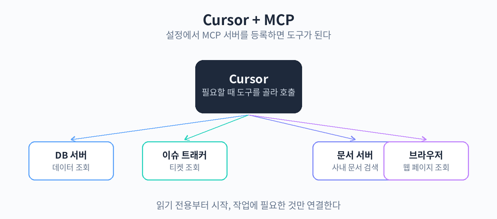

# Part 5. Rules와 팀

## 51. MCP 서버 연동



에이전트가 코드베이스 안에서 일하는 데는 한계가 있다. 데이터베이스에 직접 질의하거나, 이슈 트래커의 티켓 내용을 읽거나, 회사 위키 문서를 검색하거나, 브라우저로 실제 화면을 확인해야 할 때가 있다. MCP(Model Context Protocol) 서버를 연동하면 이런 외부 도구를 에이전트가 직접 호출할 수 있다.

MCP는 AI가 외부 도구와 대화하는 표준 규격이다. Cursor 설정에서 MCP 서버를 등록하면, 에이전트가 필요할 때 해당 서버의 기능을 호출한다. 예를 들어 DB 조회용 MCP 서버가 있으면 "지난주에 가입한 사용자 수를 알려줘" 같은 지시를 에이전트가 SQL로 바꿔 실행하고 결과를 정리해 준다.

설정 방법은 다음과 같다.

1. Cursor 설정에서 MCP 항목을 연다.
2. 서버 추가를 선택하고, 서버 이름과 실행 명령 또는 URL을 입력한다.
3. 서버가 정상 등록됐는지 상태 표시를 확인한다.
4. 에이전트 입력창에서 "등록된 MCP 도구 목록을 보여줘"라고 물어 연결을 확인한다.

설정 파일의 예는 JSON 형식이며, 대략 다음과 같은 구조를 가진다.

```json
{
  "mcpServers": {
    "docs-search": {
      "command": "npx",
      "args": ["-y", "docs-mcp-server"],
      "env": {
        "DOCS_API_KEY": "여기에_키_입력"
      }
    }
  }
}
```

자주 쓰이는 MCP 서버 유형은 몇 가지로 정리된다. 문서 검색형은 회사 위키나 공식 문서를 에이전트가 직접 찾아 읽게 한다. DB 조회형은 읽기 전용 쿼리로 데이터를 가져오게 한다. 이슈 트래커형은 티켓 내용을 읽고 관련 브랜치 작업을 돕는다. 브라우저형은 실제 화면을 열어 확인하거나 스크린샷을 찍게 한다. 각 서버의 정확한 설정 방법은 해당 서버의 문서를 참고하자.

안전하게 시작하는 순서가 중요하다. 첫째, 읽기 전용부터 시작한다. DB는 조회만 가능한 계정으로 연결하고, 파일 쓰기 권한이 있는 서버는 나중에 추가한다. 둘째, 처음에는 한두 개만 등록하고, 에이전트가 도구 호출을 어떻게 하는지 관찰한다. 셋째, API 키나 토큰은 설정 파일에 평문으로 두지 말고 환경 변수나 비밀 관리 방식을 쓴다. 넷째, 도구를 호출할 때마다 무엇을 실행하는지 로그를 확인하는 습관을 들인다.

실무 예시를 하나 들어보자. 이슈 트래커와 문서 검색 MCP가 등록되어 있다면 다음과 같은 지시가 가능하다.

```text
이슈 PROJ-1234의 내용을 읽고, 관련 위키 문서에서
이 기능의 배경을 찾아줘. 그리고 수정해야 할 파일을
목록으로 정리해줘. 아직 코드는 고치지 마.
```

에이전트는 티켓을 읽고, 문서를 검색하고, 코드베이스를 탐색한 뒤 수정 후보 파일 목록을 보여준다. 실제 수정은 목록을 검토한 뒤에 지시하면 된다.

주의점은 명확하다. MCP는 외부 시스템에 손을 대는 만큼, 권한 설정이 곧 안전이다. 쓰기 권한이 있는 서버는 승인 설정을 매번 확인 모드로 두고, 어떤 명령이 실행되는지 눈으로 보자. 서버마다 제공하는 기능이 다르니, 공식 문서에서 지원하는 도구 목록을 먼저 확인하는 것이 좋다.

핵심 정리
- MCP 서버를 등록하면 에이전트가 DB 조회, 이슈 트래커, 문서 검색, 브라우저 같은 외부 도구를 호출할 수 있다.
- 설정은 Cursor의 MCP 항목에서 서버를 추가하는 방식으로 하며, 읽기 전용부터 시작하는 것이 안전하다.
- 쓰기 권한 서버는 매번 확인 모드로 두고, 비밀 값은 평문으로 저장하지 않는다.
