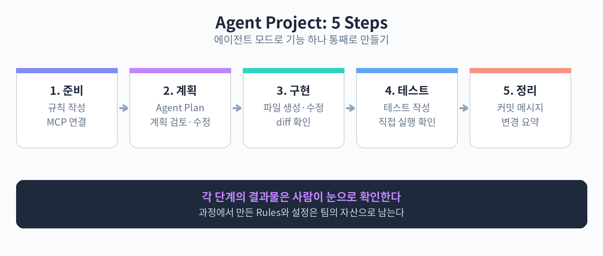

# Part 7. 실전 프로젝트

## 70. 에이전트 모드로 기능 하나 통째로 만들기

지금까지 배운 내용을 하나로 묶어보자. 에이전트 모드, 터미널 승인, Rules, 테스트를 활용해 작은 기능을 처음부터 끝까지 만드는 5단계 실습이다. 예제는 할 일(Todo) 목록에 마감일 표시와 필터 기능을 추가하는 것이다. 프로젝트 상황에 맞게 바꿔서 따라 하면 된다.

1단계: 요구사항 정리

에이전트에게 맡기기 전에 사람이 먼저 요구사항을 적는다. 에이전트는 모호함을 채우지 못한다. 메모장에 이렇게 정리한다.

```text
- 할 일 항목에 마감일(deadline) 필드를 추가한다.
- 마감일이 지난 항목은 빨간색으로 표시한다.
- "전체 / 진행 중 / 완료 / 마감 임박" 필터 버튼을 목록 상단에 추가한다.
- 기존 데이터에 마감일이 없어도 오류 없이 동작해야 한다.
```

2단계: 관련 파일 탐색

에이전트에게 탐색을 맡긴다. 바로 수정을 지시하지 말고, 먼저 구조를 파악하게 한다.

```text
@src/todo 디렉터리를 살펴보고,
할 일 목록 기능과 관련된 파일 목록을 정리해줘.
데이터 구조와 렌더링 흐름을 간단히 설명해줘. 아직 수정하지 마.
```

에이전트가 보여준 파일 목록과 설명을 읽고, 요구사항과 맞는지 확인한다. 탐색 결과가 어긋나면 여기서 방향을 바로잡는다.



3단계: 계획 수립

구체적인 수정 계획을 요청한다.

```text
아까 정리한 요구사항대로 기능을 추가하려고 해.
어떤 파일을 어떻게 바꿀지 단계별 계획을 세워줘.
테스트 계획도 포함해줘.
```

계획을 읽으며 빠진 부분이 없는지 본다. 기존 데이터 호환(마감일이 없는 경우) 같은 요구사항이 계획에 반영됐는지 확인한다. 계획이 마음에 들면 승인을 알린다.

4단계: 실행과 승인

에이전트에게 실행을 지시한다.

```text
방금 세운 계획대로 수정해줘.
각 파일의 변경은 diff로 확인하고 승인할게.
수정이 끝나면 테스트를 실행해줘.
```

터미널 명령은 승인 설정에 따라 확인하며 진행한다. diff를 하나씩 보며 요구사항과 다른 방향으로 가면 즉시 멈추고 수정 요청을 한다. "마감 임박"의 기준(예: 3일 이내)이 코드에 어떻게 반영됐는지 눈으로 확인하는 것이 중요하다.

5단계: 검증과 정리

마지막으로 결과를 검증한다.

1. 에이전트가 실행한 테스트 결과를 확인한다.
2. 직접 앱을 띄워 필터 버튼을 눌러보고, 마감일 지난 항목이 빨간색으로 보이는지 확인한다.
3. 기존 데이터(마감일 없음)로도 오류 없이 뜨는지 확인한다.
4. 테스트가 통과하면 커밋한다. 커밋 메시지에 에이전트와 함께 작업했음을 남겨두면 나중에 추적하기 좋다.

이 실습의 핵심은 단계를 나누는 것이다. 탐색, 계획, 실행, 검증을 한 번에 맡기면 어디서 어긋났는지 알기 어렵다. 단계마다 사람이 확인하는 지점을 두면, 에이전트의 속도와 사람의 판단이 함께 굴러간다.

주의점도 정리하자. 첫째, 1단계 요구사항을 건너뛰고 바로 "기능 추가해줘"라고 하면 결과물이 들쭉날쭉해진다. 둘째, 실행 단계에서 모든 diff를 승인만 하다 보면 원치 않는 변경이 끼어든다. 셋째, 검증은 에이전트에게만 맡기지 말고 직접 눈으로 확인하는 과정을 포함하자.

핵심 정리
- 요구사항 정리, 파일 탐색, 계획 수립, 실행과 승인, 검증과 정리의 5단계를 나눠 진행한다.
- 탐색과 계획 단계에서 방향을 바로잡으면 실행 단계의 시행착오가 줄어든다.
- 각 단계마다 사람이 확인하는 지점을 두어 에이전트의 속도와 판단의 균형을 맞춘다.
